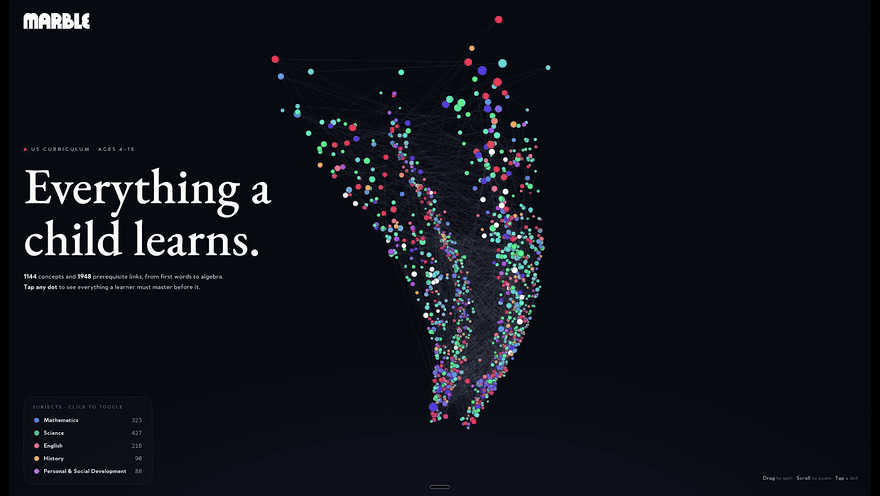

# Socratic Foundry Map

A graph of what children learn, adapted for US homeschooling: 1,590 micro-topics, 3,221 prerequisite links, US spelling and vocabulary, and US grade levels on every topic. It is the open skill-map layer of the Socratic Foundry homeschool platform; lessons, practice items, semester plans and learner data live elsewhere.

This is an adaptation of the [Marble Skill Taxonomy v1](https://github.com/withmarbleapp/os-taxonomy) (commit `96a7933`). The first commit on `main` is Marble's data unchanged, so every change is visible in git history.

> Contains the Marble Skill Taxonomy (v1) · © Generative Spark, Inc. (Marble) · https://withmarble.com · licensed under ODbL 1.0 (database) and CC BY-SA 4.0 (content). Modifications © Socratic Foundry contributors, released under the same licenses.

## What changed from upstream

| Change | Where |
| --- | --- |
| UK spelling to US (recognize, color, meter, analyze, modeling, …) | `adaptation/us/spelling.json` |
| UK vocabulary to US (period, quotation marks, parentheses, flashlight, cookies, students, counterclockwise, customary units, …) | `adaptation/us/rules.mjs` |
| Pounds and pence to dollars and cents; UK coin topics rewritten for pennies, nickels, dimes and quarters | `adaptation/us/rules.mjs` |
| UK school years and key stages to US grades (Year 3 → grade 2, KS2 → grades 2–5) | `adaptation/us/rules.mjs` |
| `gradeStart` / `gradeEnd` on every topic and `gradeStart` on every cluster (PK–12) | `data/topics.json`, `data/clusters.json`, `schema/` |
| 262 new Common Core math links for K–6 topics (every K–5 math standard now has at least one topic), with alignment and a note per link | `adaptation/us/links/ccss-math.json` |
| 130 new Common Core ELA links for K–6 English topics (every K–6 RF, RL, RI, W, SL and L standard except W.5.10 now has at least one topic), with alignment, notes, and the six standards left unlinked and why | `adaptation/us/links/ccss-ela.json` |
| Every changed text field, before and after | `adaptation/us/changes.csv` |
| Topics that still need a human rewrite (UK spelling rules, English history, metric-only measurement) | `adaptation/us/review-needed.md` |

`curriculum-standards.json` is untouched: the UK, Common Core and other standards are shown as their publishers wrote them.

### How grades are assigned

UK ages map to US grades with age 5 as kindergarten. A topic for ages 7–9 becomes grades 2–3. The range is then widened to include the grade of any Common Core or NGSS standard the topic links to. 1,470 of 1,590 topics start between pre-K and grade 6.

## Re-running the conversion

```bash
node scripts/americanize.mjs           # rewrites data/*.json, changes.csv, review-needed.md
node scripts/apply-standard-links.mjs  # adds the links in adaptation/us/links/ to topics.json, widens grades to match
node scripts/validate.mjs              # structure, references, grades, checksums
```

The conversion is safe to re-run: its rules only match UK forms, so a second run changes nothing. To change a conversion, edit `adaptation/us/rules.mjs` or `spelling.json`, restore `data/` from the first commit (`git checkout $(git rev-list --max-parents=0 HEAD) -- data`), and re-run.

## License

Same as upstream; see [the upstream license section](#license-1) below. In short: the database is ODbL 1.0 (share-alike), Marble's and our text is CC BY-SA 4.0, and each curriculum standard keeps its publisher's terms (see [PROVENANCE.md](PROVENANCE.md)). Products built on this data do not need to be open source, but changes to the map itself must be published under ODbL.

## About the upstream dataset: Marble Skill Taxonomy

An open, structured taxonomy of **what children learn** across the primary/elementary years — decomposed into fine-grained "micro-topics", wired into a prerequisite graph, and aligned to national curriculum standards. Produced by [Marble](https://withmarble.com).

> **Version:** `v1` · **Topics:** 1,590 · **Prerequisite edges:** 3,221 · **Subjects:** 8

### See it



Every dot is a micro-topic, colored by subject; height is age; each thread is a prerequisite ([full-quality video](media/curriculum-viz.mp4)). Explore it interactively at [withmarble.com/curriculum](https://withmarble.com/curriculum) — tap any concept to trace everything a learner must master before it.


### What this is

Most curriculum data is either a flat list of standards or locked inside a product. This dataset is a **connected graph of learning**:

- **1,590 micro-topics** — a single, teachable idea (e.g. *"Building sentences"*, *"Apparent brightness of stars"*), each with a plain-language description, mastery **evidence** criteria, a type (conceptual / procedural / representational / language / meta), a subject + domain, and an approximate age range.
- **3,221 prerequisite dependencies** — a directed acyclic graph: *"topic X depends on prerequisite Y"*, each edge tagged `hard`/`soft` and carrying a one-line **reason**.
- **Curriculum alignment** — each micro-topic links to the standards it was distilled from (NGSS, Common Core, the UK National Curriculum, and more).
- **Domain clusters** — 183 parent-friendly one-paragraph summaries per (subject, domain, age band).

#### Subjects

| Subject | Topics |
|---|---:|
| Science | 547 |
| Mathematics | 503 |
| English | 286 |
| History | 90 |
| Personal & Social Development | 88 |
| Life Skills | 37 |
| Computing | 21 |
| Learning to Learn | 18 |

### Files

All data lives in [`data/`](data/) as UTF-8 JSON. See [`schema/`](schema/) for JSON Schemas and [`manifest.json`](data/manifest.json) for counts + SHA-256 checksums.

| File | What it holds |
|---|---|
| [`data/topics.json`](data/topics.json) | The micro-topics (graph **nodes**). |
| [`data/dependencies.json`](data/dependencies.json) | Prerequisite **edges** (`topicId` depends on `prerequisiteId`). |
| [`data/curriculum-standards.json`](data/curriculum-standards.json) | The source curriculum standards, grouped by curriculum. |
| [`data/clusters.json`](data/clusters.json) | Parent-friendly domain summaries. |
| [`data/manifest.json`](data/manifest.json) | Counts, per-subject breakdown, per-file checksums. |

#### A topic

```json
{
  "id": "mt_N8CpN1EJrP",
  "type": "CONCEPTUAL",
  "subject": "English",
  "domain": "Grammar & Punctuation",
  "name": "Building sentences",
  "description": "Understand that words combine to make sentences — a sentence expresses a complete thought…",
  "ageRangeStart": 4,
  "ageRangeEnd": 6,
  "centrality": 0.257,
  "evidence": [
    "Distinguish between complete sentences and fragments",
    "Compose a complete sentence with a subject and verb"
  ],
  "assessmentPrompt": "If {{name}} says something like \"The dog\", can they tell you that's not a complete sentence…?",
  "standards": ["ccss-ela:L.K.1f", "uk-nc-2013:Eng.App2.Y1.Sent.1"]
}
```

- `id` — stable identifier (`mt_…`), referenced by dependencies and by neighbours.
- `standards` — keys into `curriculum-standards.json` (`"<curriculum-slug>:<code>"`).
- `assessmentPrompt` — a natural-language check for the idea. Contains a `{{name}}` placeholder (the child's name); substitute or strip before display.

#### A dependency

```json
{ "topicId": "mt__00ZSLnB7p", "prerequisiteId": "mt_VBl1T1sFCM", "strength": "hard",
  "reason": "Must understand vibrations make sound before finding volume patterns" }
```

`topicId` **depends on** `prerequisiteId`. Reverse the edge to get "unlocks".

### Using it

Pure data — no runtime, no dependencies. Load the JSON and go.

```js
import topics from './data/topics.json' with { type: 'json' };
import deps from './data/dependencies.json' with { type: 'json' };

const byId = new Map(topics.topics.map(t => [t.id, t]));
const prereqs = deps.dependencies
  .filter(d => d.topicId === 'mt_N8CpN1EJrP')
  .map(d => byId.get(d.prerequisiteId).name);
```

Validate structure + referential integrity:

```bash
node scripts/validate.mjs
```

### License

This dataset is **multi-licensed** — read this before you use or redistribute it.

| Layer | License |
|---|---|
| **The database** — the collection, structure, IDs, topic↔topic and topic↔standard relationships | [**ODbL 1.0**](LICENSE) — free for research **and** commercial use, **attribution** required, **share-alike** (derivative *databases* must stay open under ODbL). |
| **The textual content Marble authored** — topic `description`/`name`/`evidence`/`assessmentPrompt`, dependency `reason`s, cluster `summary`s | [**CC BY-SA 4.0**](LICENSE-CONTENT) — same spirit: attribution + share-alike. |
| **`curriculum-standards.json`** — extracted from third-party frameworks | **Not** Marble's to relicense. Each source is under **its own upstream license** — see [**PROVENANCE.md**](PROVENANCE.md). |

**Why share-alike + still commercial-friendly:** ODbL distinguishes a *derivative database* (extend/modify the taxonomy → must stay open) from a *produced work* (use it inside a product, model, or app → stays yours). So you can build a commercial product on this without open-sourcing your product; you only owe back improvements to the *taxonomy itself*.

#### Attribution

Any use must credit:

> Marble Skill Taxonomy (v1) · © Generative Spark, Inc. (Marble) · https://withmarble.com · licensed under ODbL 1.0 (database) and CC BY-SA 4.0 (content).

Plus the upstream notices in [PROVENANCE.md](PROVENANCE.md) for any curriculum standards you use. See [CITATION.cff](CITATION.cff) for a formal citation.

### What's *not* here

Deliberately excluded from this release: semantic embeddings (derived, recomputable) and any per-child / user data (never published). See [CHANGELOG.md](CHANGELOG.md).
